# Developer Architecture and Flows

How a request actually moves through the code, module by module. Every box below names a real class or method in `app/src/main/java/in/ac/iitm/cs5013/cyclebooking/`. Steps that are **planned but not built yet** are drawn dashed and marked *(planned)*.

The data these flows read and write is in [SCHEMA.md](SCHEMA.md). The module interfaces are in [ARCHITECTURE.md](ARCHITECTURE.md).

**Contents**

1. [Layered architecture](#1-layered-architecture)
2. [Who calls whom](#2-who-calls-whom)
3. [HTTP endpoints](#3-http-endpoints)
4. [End-to-end journey](#4-end-to-end-journey)
5. [Login](#5-login)
6. [Booking a cycle](#6-booking-a-cycle) (with the OCR pipeline and the booking race)
7. [Pickup at the stand](#7-pickup-at-the-stand)
8. [Return, guard note and comment](#8-return-guard-note-and-comment)
9. [State machines](#9-state-machines)
10. [Usage report](#10-usage-report)
11. [Transactions and concurrency](#11-transactions-and-concurrency)
12. [Built vs planned](#12-built-vs-planned)

---

## 1. Layered architecture

One Spring Boot process, one SQLite file. The resident's phone browser is the only client. The guard has no device: they watch the resident's screen.

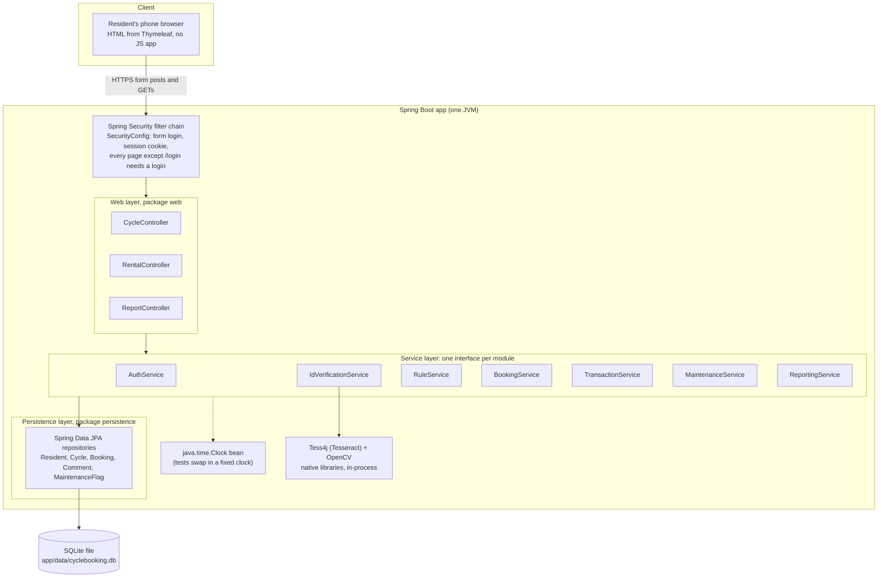

**Rules every layer follows**

- Controllers only translate HTTP into service calls and pick a template. No business logic, no repository access.
- Each module exposes one `*Service` interface; the `Default*Service` implementation is package-private, so other packages can't depend on it.
- Services return `record`s (`CycleStatus`, `CurrentRental`, …), never JPA entities, to the web layer.
- Time always comes from the injected `Clock`, never `Instant.now()`, so tests can sit exactly on the 24 h and 7-day edges.

---

## 2. Who calls whom

Taken from the constructors (what Spring injects into each class). An arrow means "holds a reference to and calls".

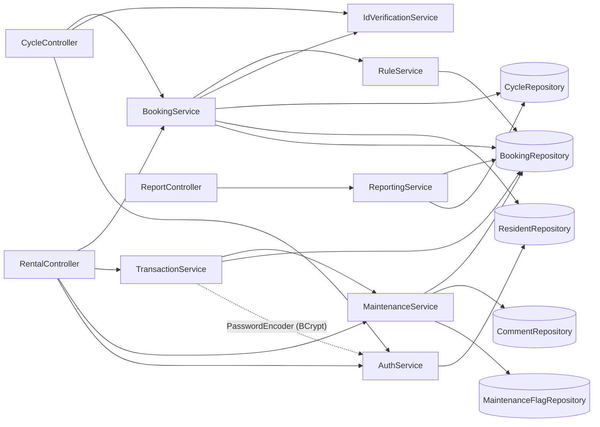

`IdVerificationService` touches no repository: it reads a photo and returns text. Nothing calls back up the graph, so there are no cycles between modules.

---

## 3. HTTP endpoints

Every `POST` ends in a redirect (post-redirect-get), so refreshing a page never repeats a booking or a return. Success and error messages travel as one-shot flash attributes.

| Method | URL | Handler | Service calls | Success → | Failure → |
|---|---|---|---|---|---|
| GET | `/login` | `CycleController.login` | — | `login.html` | |
| POST | `/login` | Spring Security | `ResidentDetailsService.loadUserByUsername`, BCrypt check | `/cycles` | `/login?error` |
| GET | `/` | `CycleController.home` | — | `/cycles` | |
| GET | `/cycles` | `CycleController.availability` | `getAvailability`, `currentResident`, `currentRental` | `cycles.html` | |
| GET | `/cycles/{id}/verify` | `CycleController.verifyPage` | `getAvailability` | `verify.html` | `/cycles` if not bookable |
| POST | `/cycles/{id}/book` (photo) | `CycleController.book` | `scanCard`, `createBooking` | `/rental` | `/cycles/{id}/verify` (ID failed) or `/cycles` (rule/lock) |
| POST | `/cycles/{id}/book-typed` | `CycleController.bookWithTypedRoll` | `createBookingWithTypedRoll` | `/rental` | same as above |
| GET | `/rental` | `RentalController.myCycle` | `currentRental` | `rental.html` | `/cycles` if none |
| POST | `/rental/pickup` (passcode) | `RentalController.pickup` | `confirmPickup` | `/rental` | `/rental` with error |
| POST | `/rental/return` (passcode, guardNote) | `RentalController.giveBack` | `confirmReturn` | `/rental/comment` | `/rental` with error |
| GET | `/rental/comment` | `RentalController.commentBox` | — | `comment.html` | `/cycles` if no return in session |
| POST | `/rental/comment` (text) | `RentalController.comment` | `submitComment` | `/cycles` | `/rental/comment` with error |
| POST | `/rental/comment/skip` | `RentalController.skipComment` | — | `/cycles` | |
| GET | `/history` | `HistoryController.history` | `currentResident`, `history` | `history.html` | |
| GET | `/report` | `ReportController.usage` | `getWeeklyUsageReport` | `report.html` | |

**The booking id is never read from a form.** Pickup and return act on the logged-in resident's own open booking (`currentRental`); the comment acts on the booking id kept in the server-side session. A resident can't act on someone else's booking by editing a hidden field.

---

## 4. End-to-end journey

The whole rental as the resident and the guard experience it, with the module that handles each step.

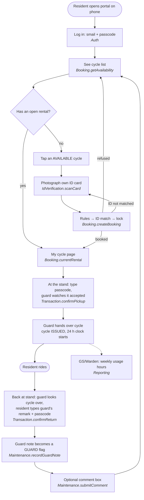

---

## 5. Login

Spring Security's form login, with our `ResidentDetailsService` supplying the user. No custom login code. ADR 0004 explains why it's passcode now and smail OAuth2 later.

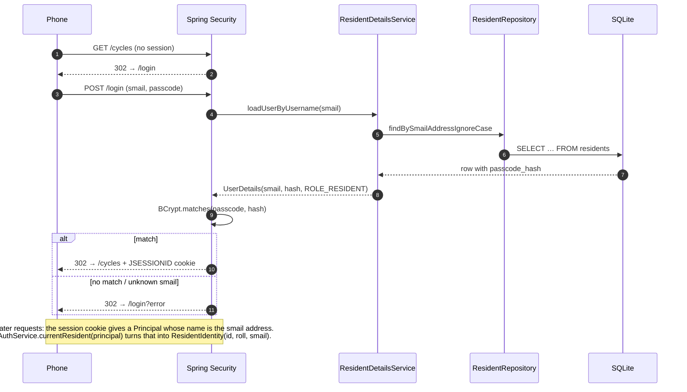

---

## 6. Booking a cycle

### 6a. Controller and service flow

Two pages: pick a cycle (`/cycles`), then scan the card (`/cycles/{id}/verify`). The order of checks inside `createBooking` is deliberate: **rules first** (no point asking for a better photo from someone who can't book), **then ID**, **then the lock** (only claim the cycle once everything else has passed).

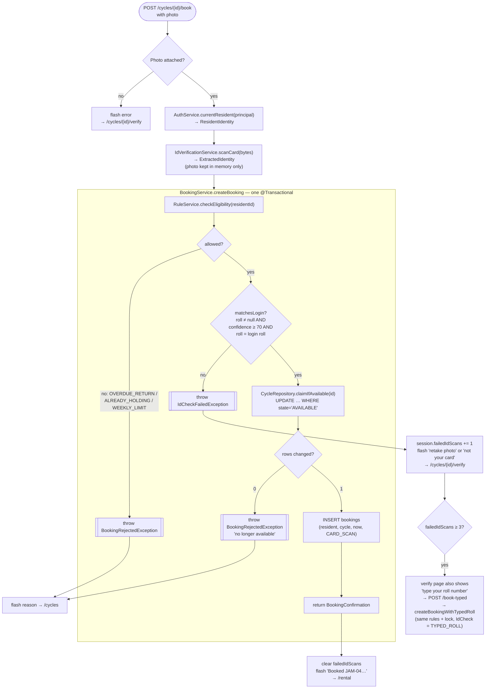

Any exception inside the transaction rolls it back, so a refused booking leaves no row and no change to the cycle.

### 6b. OCR pipeline inside `scanCard`

`IdCardPreprocessor` (OpenCV) → `IdCardScanner` (Tesseract) → `IdCardTextParser` (regex). Three differently-cleaned copies of the photo are read and the roll number most of them agree on wins. This came from the week-3 real-card failure (PROGRESS, Week 3).

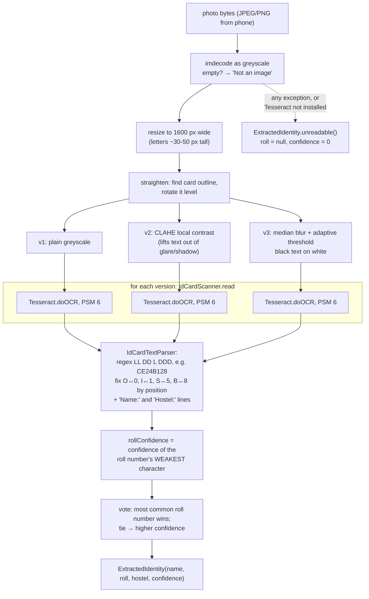

`scanCard` is `synchronized`: one Tesseract instance isn't thread-safe, and a scan takes about a second, so a second scan at the same moment just waits.

The confidence threshold doesn't stop every misread (an 8 read as a 5 scored 95+). What actually stops a wrong booking is the last check in `matchesLogin`: the roll number read must **equal** the logged-in resident's own.

### 6c. Two residents, one cycle

Why the lock is a single conditional `UPDATE` and not "read the state, then write it": between someone's read and write, another request could read the same `AVAILABLE`. The database runs one `UPDATE` at a time on that row, so only the first one finds `state = 'AVAILABLE'`.

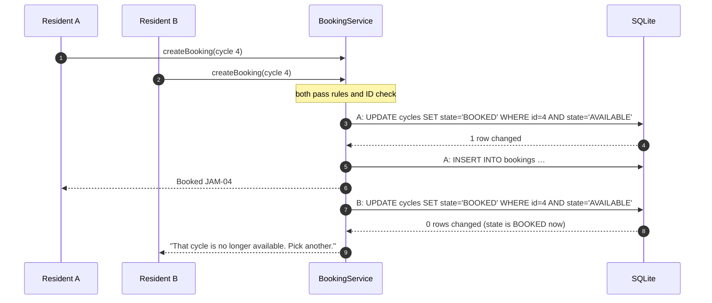

Tested by `DefaultBookingServiceTest.createBooking_rejectsSecondConcurrentBookingOfSameCycle` with two real threads on real SQLite.

---

## 7. Pickup at the stand

The passcode is the same one used to log in, checked against the same BCrypt hash. Typing it in front of the guard ties the person at the stand to the account that booked.

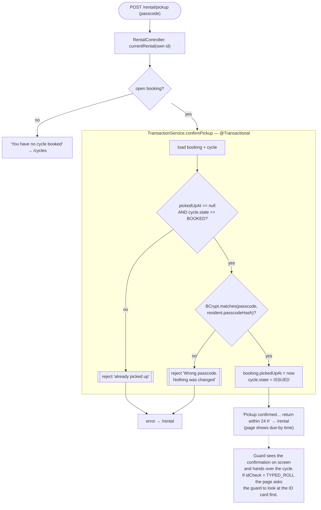

The order matters: state checks, then passcode, then changes. A wrong passcode always leaves the booking and the cycle exactly as they were.

---

## 8. Return, guard note and comment

The return and the guard's note are saved in **one transaction**: if saving the note fails, the return is rolled back too, so a cycle can't come back `AVAILABLE` with the guard's warning lost.

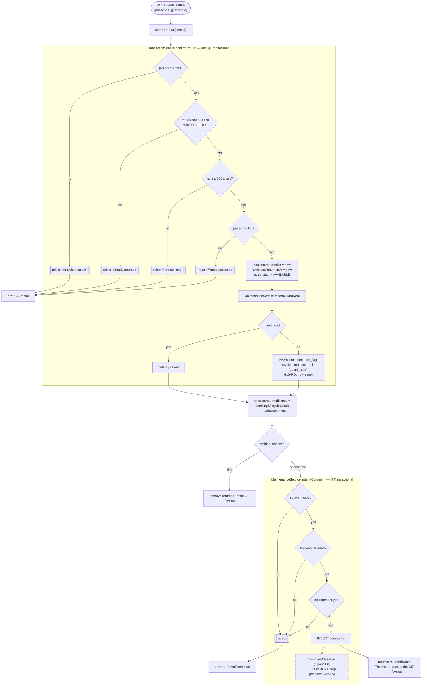

---

## 9. State machines

### Cycle (`cycles.state`)

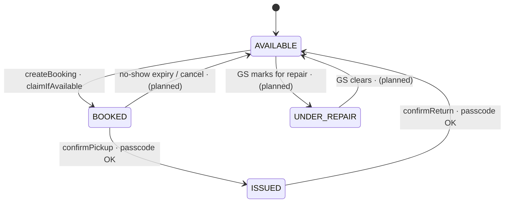

Built today: the three transitions in the top cycle. A guard flag **does not** change the cycle's state; it only adds a row to `maintenance_flags`. `UNDER_REPAIR` exists in the enum and the seed data but nothing in the code sets or clears it yet.

### Booking (derived from its timestamps)

A booking has no `state` column; its stage is read from which timestamps are set.

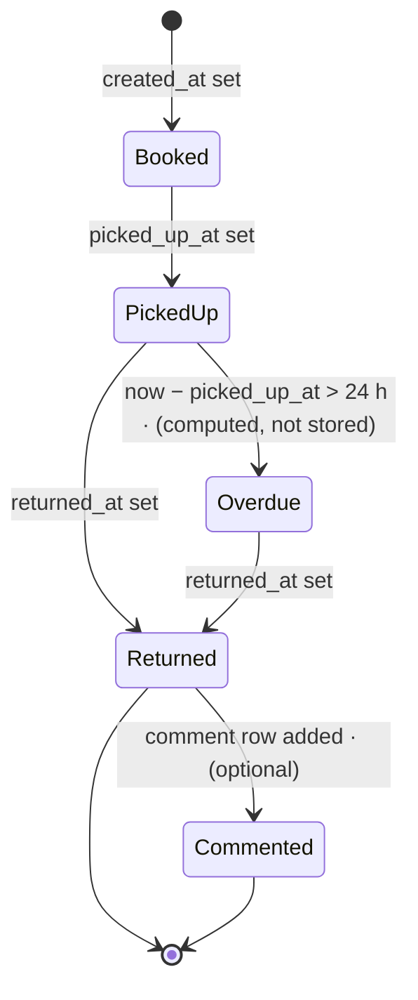

| Stage | `picked_up_at` | `returned_at` | Counts as "open"? |
|---|---|---|---|
| Booked | null | null | yes |
| Picked up | set | null | yes |
| Overdue | set, > 24 h ago | null | yes. New bookings refused with `OVERDUE_RETURN` |
| Returned | set | set | no |

---

## 10. Usage report

`GET /report` → `ReportingService.getWeeklyUsageReport()` → window = last 7 days ending now.

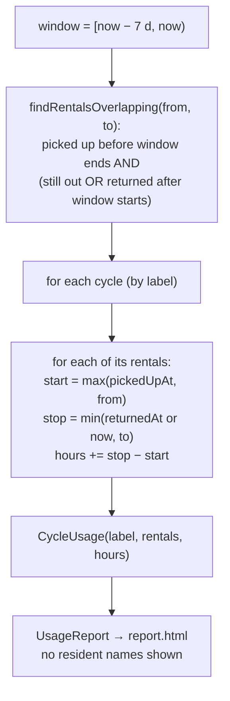

Usage counts from pickup to return, the time the cycle was actually away from the stand. Time booked but not yet picked up isn't usage.

---

## 11. Transactions and concurrency

| Operation | Transaction | What is atomic | Concurrency control |
|---|---|---|---|
| `createBooking` / `createBookingWithTypedRoll` | `@Transactional` | rule check + claim + insert booking | conditional `UPDATE`, rows-changed = 1 |
| `confirmPickup` | `@Transactional` | booking.pickedUpAt + cycle.state | `@Version` on `Cycle` (stale write fails) |
| `confirmReturn` | `@Transactional` | return + cycle state + guard flag | `@Version` on `Cycle` |
| `submitComment` | `@Transactional` | checks + insert | one comment per booking checked in the same transaction |
| reads (`getAvailability`, `currentRental`, reports, rules) | `readOnly = true` | — | — |
| `scanCard` | none (no DB) | — | `synchronized` around Tesseract |

The DB connection pool has one connection (`spring.datasource.hikari.maximum-pool-size=1`): SQLite allows one writer at a time anyway, and a single connection avoids `SQLITE_BUSY` errors under load.

---

## 12. Built vs planned

| Piece | Status | Week |
|---|---|---|
| Login (smail + passcode) | built | 1 |
| Availability page | built | 1 |
| Rule engine (24 h, 3/week, one open rental) | built | 2 |
| Booking with race-safe lock | built | 2 |
| OCR ID check + typed-roll fallback | built | 3 |
| Passcode pickup / return | built | 3 |
| Usage report v1 | built | 3 |
| Guard note at return → GUARD flag | built | 4 |
| Post-return comment box | built | 4 |
| Comment classifier → COMMENT flags | planned | 5 |
| GS maintenance list, resolve flags, `UNDER_REPAIR` | planned | 5 |
| GS-only role for `/report` | planned | 5 |
| Booking cancel / no-show expiry | not yet scheduled | — |
| GS override of rule limits | planned | 7 |
| smail OAuth2 instead of passcode | depends on IT approval (ADR 0004) | — |
