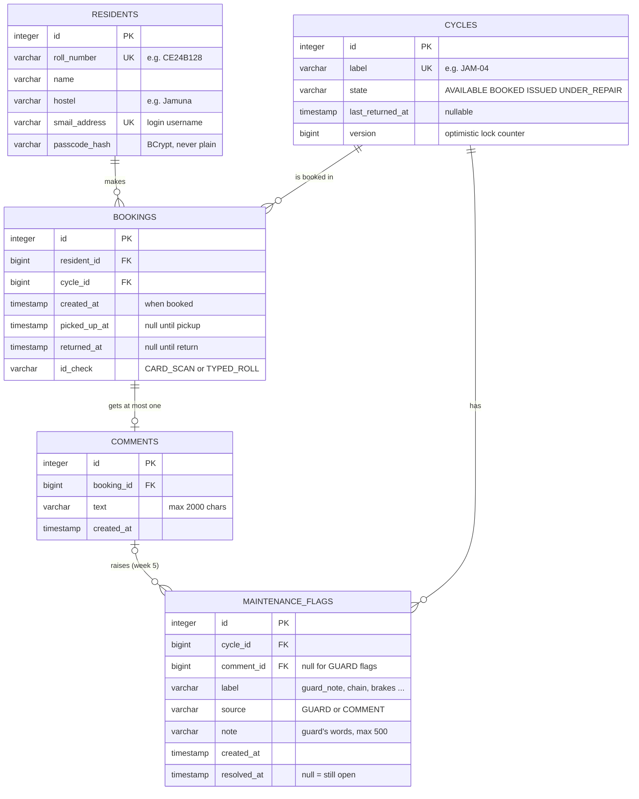
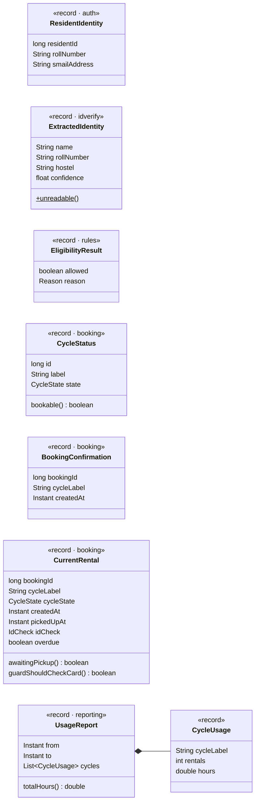

# Data Schema

The data model as it is in the code today (week 4), not as planned. Everything here was checked against the entity classes in `app/src/main/java/.../persistence/` and against the table definitions Hibernate actually created in `app/data/cyclebooking.db` (dumped with `sqlite3 data/cyclebooking.db .schema` on 12 Oct 2026).

For how these objects move through a request, see [FLOWS.md](FLOWS.md).

---

## 1. Entity-relationship diagram

Five tables. Every arrow is a `@ManyToOne` in Java, a `*_id` column in SQL.

**Cardinality in words**

- A resident has many bookings over time, but **at most one open booking** at a time. The Rule Engine enforces this, not the database (see §5).
- A cycle has many bookings over time, but at most one open booking. The booking lock enforces this: `cycles.state` must be `AVAILABLE` to book.
- A booking has **zero or one** comment. `MaintenanceService.submitComment` enforces this.
- A cycle has many maintenance flags. A flag comes either from a guard's note at return (`source = GUARD`, `comment_id = null`) or, from week 5, from the classifier reading a resident's comment (`source = COMMENT`, `comment_id` set).

---

## 2. Tables, column by column

SQL types are what Hibernate generated on SQLite. `id integer primary key` makes SQLite assign the id on insert (`@GeneratedValue(strategy = IDENTITY)`).

### `residents` — `Resident.java`

| Column | SQL type | Constraint | Java field | Meaning |
|---|---|---|---|---|
| `id` | integer | PK | `Long id` | Internal id. Other tables point at this. |
| `roll_number` | varchar(255) | NOT NULL, UNIQUE | `String rollNumber` | Institute roll number. The OCR result is compared against this. |
| `name` | varchar(255) | NOT NULL | `String name` | Display name. |
| `hostel` | varchar(255) | NOT NULL | `String hostel` | Always "Jamuna" for now. |
| `smail_address` | varchar(255) | NOT NULL, UNIQUE | `String smailAddress` | Login username. Stays the identity key if OAuth2 replaces passcodes (ADR 0004). |
| `passcode_hash` | varchar(255) | NOT NULL | `String passcodeHash` | BCrypt hash. Used for login **and** for pickup/return confirmation. |

No ID card photo column exists, by design. The photo lives in memory for one request only (ADR 0003).

### `cycles` — `Cycle.java`

| Column | SQL type | Constraint | Java field | Meaning |
|---|---|---|---|---|
| `id` | integer | PK | `Long id` | |
| `label` | varchar(255) | NOT NULL, UNIQUE | `String label` | What is painted on the cycle, e.g. `JAM-04`. |
| `state` | varchar(255) | NOT NULL, CHECK in enum | `CycleState state` | Current state. See the state machine in [FLOWS.md §9](FLOWS.md#9-state-machines). |
| `last_returned_at` | timestamp | nullable | `Instant lastReturnedAt` | Set on every return. |
| `version` | bigint | NOT NULL | `Long version` (`@Version`) | Bumped on every change. JPA refuses a write based on a stale read. The booking UPDATE also bumps it. |

### `bookings` — `Booking.java`

One row per rental, from booking to return. The row is never deleted; it is the usage history the report reads.

| Column | SQL type | Constraint | Java field | Meaning |
|---|---|---|---|---|
| `id` | integer | PK | `Long id` | |
| `resident_id` | bigint | NOT NULL | `Resident resident` | Who booked. |
| `cycle_id` | bigint | NOT NULL | `Cycle cycle` | Which cycle. |
| `created_at` | timestamp | NOT NULL | `Instant createdAt` | Booking time. The 3-per-week rule counts these. |
| `picked_up_at` | timestamp | nullable | `Instant pickedUpAt` | Set by `confirmPickup`. Usage hours start here. |
| `returned_at` | timestamp | nullable | `Instant returnedAt` | Set by `confirmReturn`. `NULL` means the booking is still open. |
| `id_check` | varchar(255) | CHECK in enum, nullable | `IdCheck idCheck` | How identity was proved. `TYPED_ROLL` tells the guard to look at the physical card. Null only on week-2 rows. |

**Derived, not stored:** `overdue`. `Booking.isOverdue(now)` is true when `picked_up_at` is set, `returned_at` is null, and more than 24 h (`MAX_HOLD`) have passed. A stored flag would need a scheduled job to keep it up to date; computing it from the timestamps cannot go stale.

### `comments` — `Comment.java`

| Column | SQL type | Constraint | Java field | Meaning |
|---|---|---|---|---|
| `id` | integer | PK | `Long id` | |
| `booking_id` | bigint | NOT NULL | `Booking booking` | The returned rental this is about. |
| `text` | varchar(2000) | NOT NULL | `String text` | The resident's words, trimmed, kept exactly. Shown to the GS next to any flags (ADR 0003). |
| `created_at` | timestamp | NOT NULL | `Instant createdAt` | |

### `maintenance_flags` — `MaintenanceFlag.java`

| Column | SQL type | Constraint | Java field | Meaning |
|---|---|---|---|---|
| `id` | integer | PK | `Long id` | |
| `cycle_id` | bigint | NOT NULL | `Cycle cycle` | The cycle with the problem. |
| `comment_id` | bigint | nullable | `Comment comment` | The comment that raised it. Null for guard flags. |
| `label` | varchar(255) | NOT NULL | `String label` | Issue type. Today always `guard_note`. From week 5 the classifier labels, e.g. `chain`, `brakes`, `tyre`. |
| `source` | varchar(255) | NOT NULL, CHECK in enum | `FlagSource source` | `GUARD` or `COMMENT`. |
| `note` | varchar(500) | nullable | `String note` | The guard's words at return. Null for comment flags. |
| `created_at` | timestamp | NOT NULL | `Instant createdAt` | |
| `resolved_at` | timestamp | nullable | `Instant resolvedAt` | Null = still needs fixing. Nothing sets it yet (GS view, week 5). |

---

## 3. Enums

Stored as their name (`@Enumerated(EnumType.STRING)`), so reordering the Java enum can't corrupt old rows. Hibernate adds a `CHECK` constraint listing the allowed names.

| Enum | Values | Used in |
|---|---|---|
| `CycleState` | `AVAILABLE`, `BOOKED`, `ISSUED`, `UNDER_REPAIR` | `cycles.state` |
| `IdCheck` | `CARD_SCAN`, `TYPED_ROLL` | `bookings.id_check` |
| `FlagSource` | `GUARD`, `COMMENT` | `maintenance_flags.source` |
| `EligibilityResult.Reason` | `OK`, `OVERDUE_RETURN`, `ALREADY_HOLDING`, `WEEKLY_LIMIT` | Not stored. Returned by the Rule Engine, each value carries the message shown to the resident. |

---

## 4. Objects that are not tables

Modules pass Java `record`s to each other instead of JPA entities, so no caller outside a module gets an object it could accidentally save. These are what each service interface takes and returns.

| Object | Made by | Read by | Notes |
|---|---|---|---|
| `ResidentIdentity` | `AuthService.currentResident` | every controller, `BookingService` | Who is logged in. Built from the `residents` row matching the login. |
| `ExtractedIdentity` | `IdVerificationService.scanCard` | `BookingService.createBooking` | What OCR read. `confidence` is 0–100, the score of the roll number's **weakest** character. Never saved. |
| `EligibilityResult` | `RuleService.checkEligibility` | `BookingService` | `allowed` plus the reason to show. |
| `CycleStatus` | `BookingService.getAvailability` | `/cycles` page | One row per cycle. |
| `BookingConfirmation` | `BookingService.createBooking*` | `CycleController` | What the success message shows. |
| `CurrentRental` | `BookingService.currentRental` | `/rental` page, `RentalController` | The open booking plus derived `overdue`. |
| `UsageReport` / `CycleUsage` | `ReportingService` | `/report` page | Hours each cycle was out, last 7 days. No resident names. |

**HTTP session attributes** (server-side, per logged-in browser):

| Key | Type | Set by | Purpose |
|---|---|---|---|
| `failedIdScans` | `Integer` | `CycleController` on each `IdCheckFailedException` | After 3, the typed-roll fallback is offered. Cleared on a successful booking. |
| `returnedRental` | `ReturnedRental(bookingId, cycleLabel)` | `RentalController` after a confirmed return | Which booking the comment box is for. Kept in the session so a resident can't comment on someone else's booking by editing a form field. |

---

## 5. Integrity rules and where each is enforced

| Rule | Enforced by | Where |
|---|---|---|
| Roll number, smail address and cycle label are unique | Database | `UNIQUE` constraints |
| Enum columns hold only valid names | Database | `CHECK` constraints |
| Two residents can't book the same cycle | Database | Conditional `UPDATE cycles ... WHERE state = 'AVAILABLE'`, changed-row count checked (`CycleRepository.claimIfAvailable`) |
| One open booking per resident | Service | `RuleService` refuses if `findOpenBookingForResident` finds one |
| At most 3 bookings per rolling 7 days | Service | `RuleService`, `countByResidentIdAndCreatedAtAfter(now − 7 d)` |
| Pickup only from `BOOKED`, return only from `ISSUED` | Service | `DefaultTransactionService` state checks |
| One comment per booking, only after return | Service | `DefaultMaintenanceService.submitComment` |
| `booking.resident_id` / `cycle_id` point at real rows | **JPA only** | See gap below |

**Gaps to know about**

1. **No foreign keys in the database.** The generated SQLite tables have no `FOREIGN KEY` clauses: Hibernate's community SQLite dialect doesn't emit them, and SQLite enforces them only when `PRAGMA foreign_keys = ON` is set. Today every insert goes through JPA with a loaded entity, so the ids are always real. A hand-written SQL insert could still create an orphan row.
2. **"One open booking per resident" has no DB constraint.** It holds today only because the app has a single DB connection (`hikari.maximum-pool-size=1`), so two booking transactions can't run at the same time. If the pool is ever enlarged, two simultaneous bookings by the *same* resident for *different* cycles could both pass the rule check. No test covers this.
3. **A booking that is never picked up holds the cycle forever.** There's no cancel or expiry yet (listed under Blocked in PROGRESS).

---

## 6. Repository queries

What each query is for. JPQL is written against entities. Spring derives the "derived" ones from the method name.

| Repository method | Kind | SQL meaning | Used by |
|---|---|---|---|
| `ResidentRepository.findBySmailAddressIgnoreCase` | derived | `WHERE lower(smail_address) = lower(?)` | login, `AuthService` |
| `CycleRepository.findAllByOrderByLabelAsc` | derived | all cycles by label | availability, report |
| `CycleRepository.claimIfAvailable(id)` | JPQL `UPDATE` | `UPDATE cycles SET state='BOOKED', version=version+1 WHERE id=? AND state='AVAILABLE'` → rows changed (1 = got it, 0 = lost) | booking lock |
| `BookingRepository.findOpenBookingForResident` | JPQL | `WHERE resident_id=? AND returned_at IS NULL` | rules, "My cycle" |
| `BookingRepository.countByResidentIdAndCreatedAtAfter` | derived | `COUNT(*) WHERE resident_id=? AND created_at > ?` | 3-per-week rule |
| `BookingRepository.findRentalsOverlapping(from, to)` | JPQL | `picked_up_at IS NOT NULL AND picked_up_at < to AND (returned_at IS NULL OR returned_at > from)` | usage report |
| `CommentRepository.findByBookingId` | derived | comments for one booking | one-comment check |
| `MaintenanceFlagRepository.findByResolvedAtIsNullOrderByCreatedAtDesc` | derived | open flags, newest first | GS list (week 5) |

---

## 7. Seed data

`app/src/main/resources/data.sql` runs on every start and inserts only rows that don't exist yet: one demo resident (`CE24B128`, passcode `cycle1234`, dev only) and cycles `JAM-01`…`JAM-05` in mixed states so every screen has something to show.
